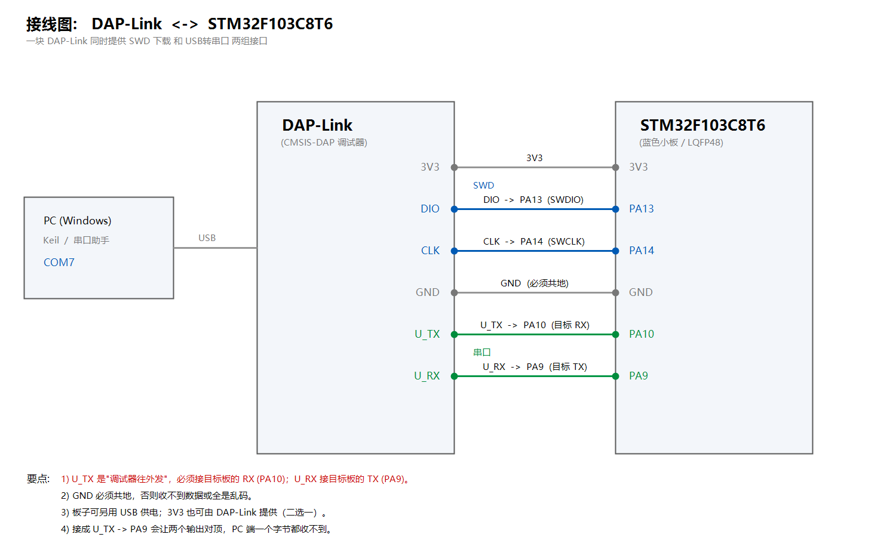
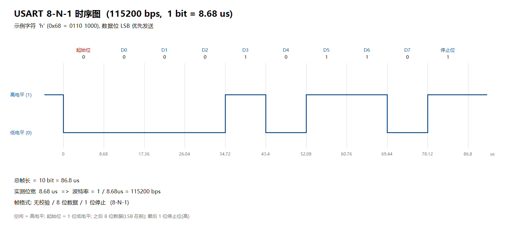

# STM32F103C8T6 串口通信实验（USART1：查询 / 中断 / DMA）

基于 **STM32CubeMX 6.18.1 + STM32Cube HAL 库** 的 USART1 串口通信实验，
运行平台为 **STM32F103C8T6（蓝色小板，LQFP48，72MHz）**，开发环境 Keil MDK（ARMCC V5.06）。

---

## 一、实验内容

**任务一 · HAL 库配置 USART1（115200 bps，8 位数据，1 位停止，无校验）**

1. STM32 连续向上位机发送 `hello windows!`；**发送之间不加延时**，观察上位机是否出现丢数据现象；
2. 上位机发送字符 `#` → STM32 暂停发送；发送字符 `*` → STM32 继续发送。

**任务二 · 串口中断与 DMA**

1. 采用**串口中断方式**重做任务一(2)；
2. 采用**串口 DMA 方式**，以 115200 bps 向上位机连续发送数据。

**任务三 · 时序分析**

在没有示波器的条件下分析串口输出时序、验证帧格式，并计算**实际波特率**。

---

## 二、硬件连接

本实验使用一块 **CMSIS-DAP（DAP-Link）** 调试器，它同时提供 SWD 下载和 USB 转串口两组接口。

**① SWD 下载**

| DAP-Link | STM32F103C8T6 |
|---|---|
| 3V3 | 3V3 |
| GND | GND |
| DIO（SWDIO）| PA13 |
| CLK（SWCLK）| PA14 |

**② 串口（注意 TX/RX 交叉）**

| DAP-Link | STM32F103C8T6 | 说明 |
|---|---|---|
| **U_TX** | **PA10**（USART1_RX）| 调试器发送 → 目标接收 |
| **U_RX** | **PA9**（USART1_TX）| 调试器接收 ← 目标发送 |
| GND | GND | 必须共地 |

> ⚠️ `U_TX` 是"调试器往外发"，必须接目标板的 **RX(PA10)**。
> 接成 `U_TX → PA9` 会让两个输出对顶，PC 端一个字节都收不到。



---

## 三、功能实现

`Core/Src/main.c` 顶部用一个宏切换 4 个实验模式，重新编译下载即可：

```c
#define TASK_1_1_NO_DELAY_TX      0   /* 任务一(1) 连续发送，不加延时         */
#define TASK_1_2_QUERY_PAUSE      1   /* 任务一(2) 查询发送 + # 暂停 / * 继续 */
#define TASK_2_1_IT_PAUSE         2   /* 任务二(1) 中断方式发送 + # / * 控制  */
#define TASK_2_3_DMA_CONTINUOUS   3   /* 任务二(3) DMA 连续发送               */

#define APP_TASK   TASK_1_1_NO_DELAY_TX     /* ★ 改这一行切换任务 */
```

四种模式均编译通过：`0 Error(s), 0 Warning(s)`。

主要实现要点：

| 模式 | 发送方式 | 关键函数 |
|---|---|---|
| 任务一(1) | 查询（阻塞） | `HAL_UART_Transmit()` |
| 任务一(2) | 查询 + 接收中断 | `HAL_UART_Transmit()` + `HAL_UART_Receive_IT()` |
| 任务二(1) | 中断 | `HAL_UART_Transmit_IT()` + 发送完成回调接力 |
| 任务二(3) | DMA | `HAL_UART_Transmit_DMA()`，DMA1 Channel4 |

`#` / `*` 命令在接收完成回调中解析：

```c
void HAL_UART_RxCpltCallback(UART_HandleTypeDef *huart)
{
  if (huart->Instance == USART1)
  {
    if (g_rx_byte == '#')       g_tx_enable = 0;   /* 暂停 */
    else if (g_rx_byte == '*')  g_tx_enable = 1;   /* 继续 */
    HAL_UART_Receive_IT(&huart1, &g_rx_byte, 1);  /* 重新开中断 */
  }
}
```

---

## 四、实验结论

1. **丢数据现象**：不加延时连续发送时上位机出现丢字节/乱码。
   根因是**发送速率 ≥ 接收方处理能力**（115200bps 连续约 11.5KB/s，串口助手刷新不过来），
   而非 USART 协议缺陷；加入延时后数据完整无丢。
2. **中断方式**：主循环可以完全空转，收发全部由中断驱动，CPU 占用明显降低。
3. **DMA 方式**：整帧数据搬运不需要 CPU 参与，只在整帧结束产生一次中断，最适合大数据量。
4. **实际波特率**：程序运行时读取寄存器
   `USART1->BRR = 0x271`（625）、`RCC->CFGR` 确认 PCLK2 = 72MHz，

   $$\text{实际波特率} = \frac{72000000}{625} = 115200\ \text{bps}$$

   与设定值完全一致（误差 0%）；串口助手能完整无误地收到数据，说明**时序正确**。



---

## 五、目录结构

```
.
├── Core/
│   ├── Inc/            main.h  stm32f1xx_hal_conf.h  stm32f1xx_it.h
│   └── Src/            main.c  stm32f1xx_it.c  stm32f1xx_hal_msp.c  system_stm32f1xx.c
├── Drivers/            STM32F1xx HAL 库 + CMSIS
├── MDK-ARM/            USART_Task.uvprojx   ← Keil 工程
├── docs/               实验报告（Markdown / PDF）
├── USART_Task.ioc      CubeMX 工程文件
└── .mxproject
```

---

## 六、编译与烧录

1. 用 **Keil MDK** 打开 `MDK-ARM/USART_Task.uvprojx`
2. 魔术棒 → **Debug** 页 → 右侧选 **CMSIS-DAP Debugger** → **Settings** → Port 选 **SW**
3. **Flash Download** 页勾选 ☑ **Reset and Run**
4. **F7** 编译，**F8** 下载
5. 打开串口助手，选择 DAP-Link 对应的 **COM 口**，参数 **115200 / 8 / 1 / None**
6. 需要切换实验任务时，修改 `Core/Src/main.c` 中的 `APP_TASK` 后重新编译下载

> 用 STM32CubeMX 重新 `GENERATE CODE` 会覆盖 `main.c`，届时需重新粘贴用户代码。

---

## 七、实验报告

- [`docs/STM32串口通信实验.md`](docs/STM32串口通信实验.md) —— 完整报告（Markdown）
- [`docs/STM32串口通信实验.pdf`](docs/STM32串口通信实验.pdf) —— 完整报告（PDF）

内容包含：CubeMX 配置步骤、三种发送方式代码与对比、时序分析、
基础题简答（串口协议 / RS-232 / RS-485 / CH340 电平区别、串口传文件的时间估算与共地原理），
以及完整踩坑记录。
