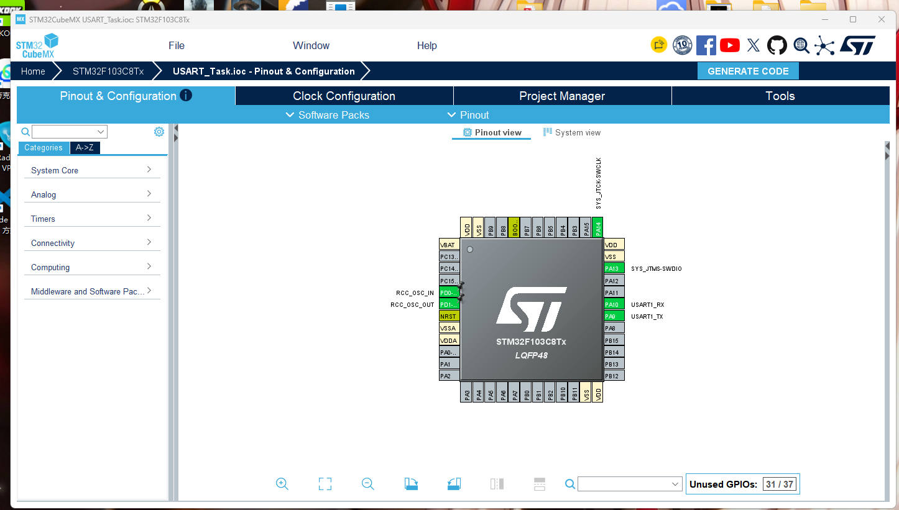

# STM32F103C8T6 串口通信实验全记录（查询 / 中断 / DMA + 时序分析）

> 用 STM32CubeMX + HAL 库，在 STM32F103C8T6（蓝色小板）上完成 USART1 的三种发送方式实验，
> 并在没有示波器的条件下完成串口时序与波特率的验证。
> 本文包含完整配置步骤、代码、现象分析，以及踩过的坑。

---

## 一、实验环境

| 项目 | 内容 |
|---|---|
| MCU | STM32F103C8T6（LQFP48，72MHz，64KB Flash） |
| 开发工具 | STM32CubeMX 6.18.1 + Keil MDK（ARMCC V5.06） |
| 库 | STM32Cube HAL（FW_F1 V1.8.7） |
| 下载/调试器 | CMSIS-DAP（DAP-Link） |
| 串口工具 | 串口助手（PC 端） |
| 串口参数 | **115200 bps，8 位数据，1 位停止，无校验（8-N-1）** |

### 接线

DAP-Link 同时提供 **SWD 调试** 和 **USB 转串口** 两组接口，所以一块板子就够了：

**① 下载（SWD）**

| DAP-Link | STM32F103C8T6 |
|---|---|
| 3V3 | 3V3 |
| GND | GND |
| DIO（SWDIO）| **PA13** |
| CLK（SWCLK）| **PA14** |
| RST | RST（可选）|

**② 串口（UART，注意交叉）**

| DAP-Link | STM32F103C8T6 | 说明 |
|---|---|---|
| **U_TX** | **PA10**（USART1_RX）| 调试器发送 → 目标接收 |
| **U_RX** | **PA9**（USART1_TX）| 调试器接收 ← 目标发送 |
| GND | GND | **必须共地** |

> ⚠️ **最容易接错的一步就是这里**：`U_TX` 是"调试器往外发"，必须接目标的 **RX(PA10)**。
> 接成 `U_TX → PA9` 会让两个输出对着顶，PC 端**一个字节都收不到**。


---

## 二、STM32CubeMX 配置要点

1. **RCC**：High Speed Clock (HSE) → `Crystal/Ceramic Resonator`（板载 8MHz 晶振）
2. **SYS**：Debug → `Serial Wire`
3. **Clock Configuration**：HSE 8MHz → PLL ×9 → **HCLK = 72MHz**，
   APB1 = /2（36MHz），APB2 = /1（72MHz）
4. **USART1**：`Asynchronous`，115200 / 8 Bits / None / 1，无硬件流控
   - **NVIC Settings**：勾选 ☑ `USART1 global interrupt`
   - **DMA Settings**：Add → `USART1_TX` → `DMA1 Channel 4`，
     Memory→Peripheral，Byte/Byte，Normal，Priority High，
     并勾选 ☑ `DMA1 channel4 global interrupt`
5. **Project Manager**：Toolchain `MDK-ARM V5`，勾选 "Copy only the necessary library files"



生成后关键文件：`Core/Src/main.c`、`Core/Src/stm32f1xx_hal_msp.c`、`Core/Src/stm32f1xx_it.c`、
`MDK-ARM/USART_Task.uvprojx`

---

## 三、任务一：查询（阻塞）方式发送

### 3.1 连续发送 hello windows!，不加延时

```c
while (1)
{
    HAL_UART_Transmit(&huart1, (uint8_t *)"hello windows!\r\n", 16, HAL_MAX_DELAY);
    /* HAL_Delay(1); */   /* 对比实验：打开延时后再观察 */
}
```

**现象**：`hello windows!` 疯狂刷屏，同时**夹杂偶发乱码/丢字节**。

**分析**：

- `HAL_UART_Transmit()` 是**阻塞式**的，内部会等 TXE 标志，**MCU 侧不会丢字节**；
- 但 115200bps 下连续发送约 **11.5 KB/s**，PC 端串口助手的"接收 → 显示"刷新速度跟不上，
  接收缓冲溢出，就表现为**丢数据/乱码**；
- 想复现**真正的 MCU 侧丢字节**，要用"不安全写法"：

```c
USART1->DR = 'A';    /* 不等 TXE 直接写数据寄存器 —— 115200 下 1 字节要 87us 才发完 */
```

**结论**：丢数据不是 USART 协议的问题，而是**发送速率 ≥ 接收方处理能力**导致的。
加入 `HAL_Delay()` 或降低发送频率后，数据即完整无丢。

> 顺带一提：用 DAP-Link 的 USB 虚拟串口接收时同样会丢，因为它内部的串口桥接缓冲也跟不上。

### 3.2 上位机发 `#` 暂停、发 `*` 继续

发送仍用查询方式，**接收用中断**（否则主循环阻塞时收不到命令）：

```c
/* 主循环 */
while (1)
{
    if (g_tx_enable)
    {
        HAL_UART_Transmit(&huart1, (uint8_t *)HELLO_STR, HELLO_LEN, HAL_MAX_DELAY);
        HAL_Delay(500);
    }
    else
    {
        HAL_Delay(10);          /* 已暂停，空转等待 '*' */
    }
}

/* 接收完成回调 */
void HAL_UART_RxCpltCallback(UART_HandleTypeDef *huart)
{
    if (huart->Instance == USART1)
    {
        if (g_rx_byte == '#')       g_tx_enable = 0;   /* 暂停 */
        else if (g_rx_byte == '*')  g_tx_enable = 1;   /* 继续 */
        HAL_UART_Receive_IT(&huart1, &g_rx_byte, 1);  /* 重新开中断 */
    }
}
```

**现象**：每 500ms 一条 `hello windows!`；发送框输入 `#` → 停住；输入 `*` → 继续。

> 💡 串口助手要注意：**别勾"HEX 发送"**，否则 `#`、`*` 根本输不进去；同时要先"打开串口"。

---

## 四、任务二：中断方式 与 DMA 方式

### 4.1 串口中断方式

核心思路：**一帧发完触发发送完成中断，在回调里接着发下一帧**，主循环完全空转。

```c
/* 启动：先发第一帧 */
HAL_UART_Receive_IT(&huart1, &g_rx_byte, 1);
g_tx_busy = 1;
HAL_UART_Transmit_IT(&huart1, (uint8_t *)HELLO_STR, HELLO_LEN);

/* 发送完成回调 —— 连续发送的"接力棒" */
void HAL_UART_TxCpltCallback(UART_HandleTypeDef *huart)
{
    if (huart->Instance == USART1)
    {
        g_tx_busy = 0;
        if (g_tx_enable)
        {
            g_tx_busy = 1;
            HAL_UART_Transmit_IT(&huart1, (uint8_t *)HELLO_STR, HELLO_LEN);
        }
    }
}
```

**现象**：与任务一(2) 完全一致（`#` 停、`*` 继续），但**主循环是空的**，
收发全部由中断驱动 —— 这就是"用中断重做串口通信"的意义。

### 4.2 DMA 方式连续发送

```c
/* 启动 */
for (i = 0; i < sizeof(g_dma_buf); i++)
    g_dma_buf[i] = (uint8_t)('A' + (i % 26));
HAL_UART_Transmit_DMA(&huart1, g_dma_buf, sizeof(g_dma_buf));

/* DMA 发送完成回调：再次启动，形成连续发送 */
void HAL_UART_TxCpltCallback(UART_HandleTypeDef *huart)
{
    if (huart->Instance == USART1)
        HAL_UART_Transmit_DMA(&huart1, g_dma_buf, sizeof(g_dma_buf));
}
```

**现象**：串口助手连续收到 `ABCDEFGHIJKLMNOPQRSTUVWXYZ...` 循环。
**整个 64 字节搬运过程不需要 CPU 参与，只在整帧结束产生一次中断。**

---

## 五、任务三：时序分析与波特率验证

### 5.1 串口帧格式

一帧 = **1 起始位 + 8 数据位（LSB 优先）+ 1 停止位 = 10 位**，
115200bps 下 **1 位 = 8.68 µs**，一帧 ≈ **86.8 µs**。


以字符 `'h'`（0x68 = `0110 1000`）为例，实际发送顺序是 **`0 0 0 1 0 1 1 0`**（低位在前）。

### 5.2 实测波特率

> **说明**：本机 Keil 的 STM32F1 仿真模型不完整（逻辑分析仪加任何信号都报
> `Unknown signal`，改为 `DARMSTM.DLL` 后 `GPIOA_ODR` / `USART1_SR` 波形仍为平直），
> 故改用 **DAP-Link 在线调试直接读寄存器** 来验证。

程序运行后暂停，在 Keil 的 Watch 窗口读取：

| 寄存器 | 实测值 | 含义 |
|---|---|---|
| `RCC->CFGR` | `0x001D040A` | SWS=`10b` → 时钟源为 PLL；PLLSRC=1 → HSE；PLLMUL=`0111` → ×9，**HSE 8MHz × 9 = 72MHz** |
| `USART1->BRR` | `0x271`（625）| 波特率分频值 |
| `USART1->CR1` | `0x20AC` | UE / TXEIE / RXNEIE / TE / RE 均已使能 |

$$\text{实际波特率} = \frac{\text{PCLK2}}{\text{BRR}} = \frac{72\,000\,000}{625} = \mathbf{115200\ bps}$$

**误差 0%，与设定值完全一致。**

### 5.3 时序正确性判断

- 空闲为高电平，起始位为 1 位低电平，8 位数据低位在前，停止位回到高电平 —— 符合 8-N-1 规范；
- **串口助手能完整无误地收到 `hello windows!`**，这本身就是时序正确的直接证据：
  只要波特率或帧格式有任何偏差，收到的必然是乱码或丢字符。

---

## 六、三种发送方式对比

| 方式 | 关键函数 | CPU 参与程度 | 适用场景 |
|---|---|---|---|
| **查询（阻塞）** | `HAL_UART_Transmit()` | 全程死等，CPU 被占满 | 少量数据、简单场合 |
| **中断** | `HAL_UART_Transmit_IT()` | 每发 1 个字节进 1 次中断 | 中小数据量，需要一边收一边发 |
| **DMA** | `HAL_UART_Transmit_DMA()` | 整帧只进 1 次中断，搬运不占 CPU | 大数据量、高速率首选 |

DMA 通道映射：`USART1_TX → DMA1 Channel 4`（STM32F103 固定映射）。

---

## 七、踩坑记录（血泪）

1. **DMA 引脚丝印不叫 TXD/RXD**：DAP-Link 上写的是 `U_TX` / `U_RX`，
   要接成 `U_TX→PA10`、`U_RX→PA9`，**接反就是一个字节都收不到**。
2. **CubeMX 手写 `.ioc` 时 DMA 必须写全子字段**：
   `Dma.USART1_TX.0=DMA1_Channel4` 会报
   *"The USART1_TX DMA request was not loaded."*，必须写成
   `Dma.USART1_TX.0.Instance=DMA1_Channel4` + Direction/Mode/Priority/… + `RequestParameters=…`。
3. **CubeMX 生成的 `USART1_IRQHandler()` 可能是空的**：
   如果 NVIC 里没勾 "Generate IRQ handler"，即使中断向量使能了，也**没有调用
   `HAL_UART_IRQHandler()`**，中断标志永远清不掉。需要在 USER CODE 段手动补上：
   ```c
   void USART1_IRQHandler(void)
   {
     HAL_UART_IRQHandler(&huart1);
   }
   ```
   同时 `HAL_UART_MspInit()` 里需要 `HAL_NVIC_EnableIRQ(USART1_IRQn);`。
4. **Keil 下载后不自动运行**：勾选 *Flash Download → Reset and Run*，否则下载完芯片停在复位状态。
5. **ARMCC V5 不支持无 BOM 的 UTF-8 源码**？——其实**支持**。
   报 `nested comment is not allowed` / `the #if for this directive is missing`
   通常是**文件内容被编辑器改乱了**（注释不闭合把代码吞了），不是编码问题。
6. **Keil 的 STM32F1 软件仿真看不到串口引脚波形**：
   CubeMX 生成的工程仿真器指向通用 Cortex-M3（`DCM.DLL -pCM3`），
   会报 `error 65: access violation at 0x40022000`；
   改成 `DARMSTM.DLL -pSTM32F103C8` 后程序能跑，但外设仍无行为模型
   （`GPIOA_ODR`、`USART1_SR` 波形全平）。
   **结论：要验证时序，请直接读寄存器或上示波器/逻辑分析仪。**
   > 另外，AF 推挽模式下 `GPIOA_ODR` 本来也不反映 USART 的输出。

---

## 八、基础题简答

### 基础1：串口协议 / RS-232 / RS-485 / CH340

- **串口（UART）**：异步串行，一帧 = 起始位 + 数据位 + 可选校验 + 停止位，双方约定波特率，数据位 LSB 优先。
- **TTL 电平**：单端对地，逻辑 1 ≈ 3.3V/5V，逻辑 0 ≈ 0V，**正逻辑**，只能板内短距离。
- **RS-232**：单端对地，**负逻辑**（逻辑 1 = −3~−15V，逻辑 0 = +3~+15V），
  ±12V 摆幅，传输距离约 15m，需 MAX232 等芯片做电平转换。
- **RS-485**：**差分**（A/B 两线），电压差 >+200mV 为 1、<−200mV 为 0，
  抗共模干扰强，可达 1200m、多点总线，需 485 收发器（如 MAX485）。
- **CH340**：USB 转串口桥接芯片。把 PC 的 USB 信号 ↔ UART 串行数据互转，
  装驱动后 PC 上虚拟出一个 COM 口；其 TXD/RXD 是 **TTL 电平**，可直接接 MCU 的 PA9/PA10。
  若是"USB 转 RS-232"模块，则在 CH340 后再接一级 MAX232，把 TTL 变成 ±12V 的 232 电平。

### 基础2：串口传输文件

**① 文件大小、波特率、传输时间的关系**

$$T \approx \frac{N_{byte}\times 10}{B}$$

时间与文件大小成正比、与波特率成反比。以 1MB 文件为例：

| 波特率 | 理论耗时 |
|---|---|
| 9600 | ≈ 8738 s（约 2.4 小时）|
| 115200 | ≈ 728 s（约 12 分钟）|
| 921600 | ≈ 91 s |

实际时间通常**略长于**理论值，因为：文件传输协议有分包/校验/应答开销、
接收端写盘与软件调度引入延迟、若启用校验位则每字节变成 11 位。

**② 只接 TX-RX、RX-TX，不接电源线 / 不接 GND**

- **不接 GND → 不能正常工作**。串口是"对地单端"信号，接收方以自己的 GND 为参考；
  两机没有公共地，电平就没有统一基准，会导致误码、乱码甚至完全收不到。
  **GND 是串口通信的必要条件。**
- **不接电源线（VCC）→ 可以正常工作**。只要两台电脑（及各自模块）**各自独立供电**，
  只接 TX、RX、GND 三根线即可，因为信号电平是相对的，不依赖对方供电。
  （前提是模块不需要对方供电，并且 **TX/RX 必须交叉**。）

**结论**：串口通信的最小条件 = **共地(GND)** + **TX↔RX 交叉**；VCC 不是必需品。

---

## 九、工程结构

```
USART_Task/
├── Core/
│   ├── Inc/    main.h  stm32f1xx_hal_conf.h  stm32f1xx_it.h
│   └── Src/    main.c  stm32f1xx_it.c  stm32f1xx_hal_msp.c  system_stm32f1xx.c
├── Drivers/    HAL 库 + CMSIS
├── MDK-ARM/    USART_Task.uvprojx   ← Keil 工程
└── USART_Task.ioc                   ← CubeMX 工程
```

`main.c` 里用一个宏切换 4 个实验任务：

```c
#define TASK_1_1_NO_DELAY_TX      0   /* 任务一(1) 连续发送，不加延时         */
#define TASK_1_2_QUERY_PAUSE      1   /* 任务一(2) 查询发送 + # 暂停 / * 继续 */
#define TASK_2_1_IT_PAUSE         2   /* 任务二(1) 中断方式发送 + # / * 控制  */
#define TASK_2_3_DMA_CONTINUOUS   3   /* 任务二(3) DMA 连续发送               */

#define APP_TASK   TASK_1_1_NO_DELAY_TX     /* ★ 改这一行切换任务 */
```

四种模式均编译通过：`0 Error(s), 0 Warning(s)`。

---

## 十、总结

- 掌握了 **STM32CubeMX 配置 USART1 + 中断 + DMA** 的完整流程；
- 理解了 **查询 / 中断 / DMA** 三种发送方式的差异与取舍；
- 明确了**丢数据的真正原因**是"发送速率 vs 接收方处理能力"，而非协议缺陷；
- 学会了在没有示波器时，**通过读 `USART1->BRR` 与 `RCC->CFGR` 反算实际波特率**；
- 踩过并记录了 DMA `.ioc` 格式、中断处理函数缺失、TX/RX 接反等实际项目中的坑。
